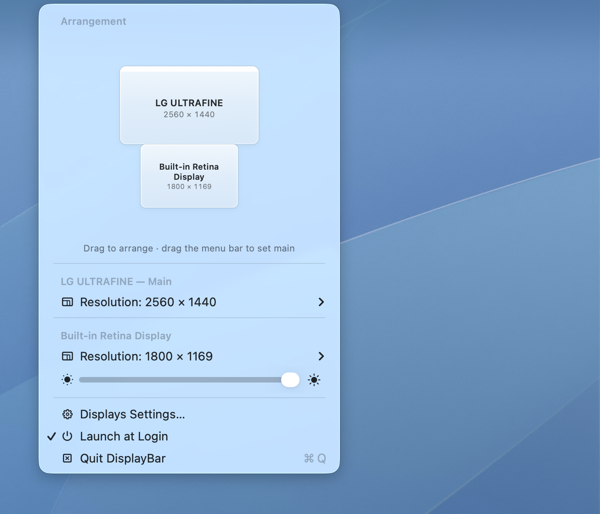

# DisplayBar

A tiny macOS menu bar app for arranging your displays, switching their resolution and adjusting
brightness: the parts of System Settings › Displays you actually use, one click away.

- **Drag to arrange:** a miniature of your displays, like the Arrange view in System Settings.
  Drag a display and it snaps flush against its neighbours (with top/centre/bottom alignment);
  drag the white menu bar onto another display to make it the main one. Changes apply when you
  let go.
- **The same resolutions as System Settings:** the recommended sizes from *Larger Text* to
  *More Space*, with the full "Show all resolutions" list one level down. No blurry
  low-resolution duplicates or modes your display wasn't designed for.
- **Brightness slider** for the built-in display, and Apple displays such as the Studio Display.
- **Small and native:** a plain AppKit app with no dependencies or background services. Changes
  persist exactly as if you'd made them in System Settings.

Brightness only works on displays macOS can dim itself. Most third-party monitors use DDC or
vendor-specific USB protocols for brightness, which aren't supported.

## Install

Requires an Apple Silicon Mac running macOS 14 or later (designed for macOS 26 Tahoe).

1. Download `DisplayBar.zip` from [Releases](../../releases/latest), unzip it, and move
   **DisplayBar.app** to Applications.
2. Open it. DisplayBar isn't notarized, so macOS will say it can't verify the developer. Go to
   **System Settings → Privacy & Security** and click **Open Anyway**.
   (Or run `xattr -dr com.apple.quarantine /Applications/DisplayBar.app`.)
3. Optionally, turn on **Launch at Login** from its menu.

## Build from source

Needs only the Xcode Command Line Tools (`xcode-select --install`).

    ./build.sh            # builds and signs ad-hoc: build/DisplayBar.app
    ./build.sh install    # …then installs to ~/Applications/DisplayBar.app and launches it

Diagnostics (changes nothing):

    DisplayBar.app/Contents/MacOS/DisplayBar --list   # displays, resolution lists, brightness support

## How it works

Arrangement and resolution changes use public CoreGraphics APIs. To offer the same resolutions
as System Settings, DisplayBar asks the private `MonitorPanel` framework (the one behind
System Settings › Displays) which modes it lists, then applies them through CoreGraphics.
Brightness uses the private `DisplayServices` framework, like the brightness keys. Both are
loaded at runtime and checked before use: if a future macOS changes them, the resolution list
falls back to the public one and the brightness slider is hidden.

## License

MIT
